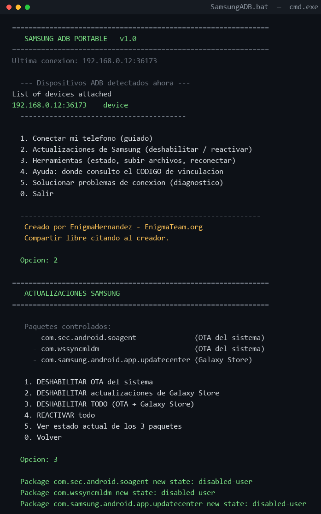

# bloquear_updates_Samsung_inalambrico

**Creado por EnigmaHernandez — [EnigmaTeam.org](https://enigmateam.org)**


Bloquea las actualizaciones de Samsung (OTA y Galaxy Store) en cualquier teléfono Samsung desde Windows, **por WiFi o USB**, sin root, sin Odin y sin instalar nada.

Todo va en una carpeta portable con su propio `adb` (Google Platform-Tools): se copia a un USB y funciona en cualquier PC con Windows 10/11.




> Probado de punta a punta con un **Samsung Galaxy A25 5G (SM-A256E, Android 15 / One UI 7)** conectado por WiFi.

---

## Qué hace

| Acción | Comando real que ejecuta |
|---|---|
| Deshabilitar OTA del sistema | `pm disable-user --user 0 com.sec.android.soagent` y `com.wssyncmldm` |
| Deshabilitar Galaxy Store | `pm disable-user --user 0 com.samsung.android.app.updatecenter` |
| Reactivar todo | `pm enable` sobre los tres paquetes |
| Estado del teléfono | `getprop`, `df -h /sdcard`, `pm list packages -d/-e` |
| Subir archivos | `adb push` a cualquier ruta, por defecto `/sdcard/Download/` |
| Verificar el binario | `certutil -hashfile adb.exe SHA256` contra la huella publicada |

`pm disable-user --user 0` no borra datos ni requiere root: solo deshabilita el paquete para el usuario principal y se revierte con `pm enable`.

---

## Contenido

```
SamsungADB.bat        Programa principal (doble clic)
LEEME.txt             Instrucciones y tabla de escenarios de fallo
README.md             Documentación principal
CHANGELOG.md          Historial de versiones y cambios
LICENSE               Licencia de uso y compartir (créditos al creador)
adb.exe               Android Debug Bridge (Platform-Tools 37.0.3)
AdbWinApi.dll         Necesario para USB
AdbWinUsbApi.dll      Necesario para USB
NOTICE.txt            Licencia de Platform-Tools (Apache-2.0)
source.properties     Versión de las herramientas
assets/menu.png       Captura del menú usada en este README
tools/                Scripts que generan la captura y la documentación
```

---

## Requisitos

- Windows 10 u 11 (64 bits).
- **USB:** driver Samsung USB. Si el teléfono no aparece, instalar *Samsung USB Driver for Mobile Phones* o Smart Switch.
- **WiFi:** PC y teléfono en la **misma red**. La depuración inalámbrica no funciona con datos móviles.

---

## Uso rápido

1. Descarga el repositorio (Code → Download ZIP) y descomprímelo.
2. Doble clic en `SamsungADB.bat`.
3. Opción **1 → 1** para vincular por WiFi, o **1 → 3** para USB.

### Menú

```
1. Conectar mi telefono
     1.1 WiFi: vincular con codigo (Android 11+)
     1.2 WiFi: ya lo vincule antes (solo reconectar)
     1.3 USB: conectar por cable
     1.4 Ver que dispositivos detecta adb
2. Actualizaciones de Samsung
     2.1 Deshabilitar OTA del sistema
     2.2 Deshabilitar Galaxy Store
     2.3 Deshabilitar TODO
     2.4 Reactivar todo
     2.5 Ver estado de los 3 paquetes
3. Herramientas
     3.1 Estado del telefono
     3.2 Subir archivo (adb push)
     3.3 Ver y actualizar IP / puerto
     3.4 Reiniciar servidor adb
     3.5 Verificar integridad de adb.exe (SHA-256)
4. Ayuda: donde consulto el codigo de vinculacion
5. Solucionar problemas de conexion (diagnostico)
```

---

## Conexión por WiFi: dónde está el código

El código de 6 dígitos **solo se muestra en la pantalla del teléfono**; ningún programa puede leerlo.

1. **Ajustes → Información del teléfono → Información del software** → tocar 7 veces *Número de compilación* (pide PIN o patrón).
2. **Ajustes → Opciones de desarrollador** → activar *Depuración USB* y *Depuración inalámbrica*. Si está en gris, el teléfono necesita estar conectado a WiFi.
3. Tocar **Depuración inalámbrica → Vincular dispositivo con código**. Aparecen:
   - el **código de 6 dígitos**,
   - la **IP y el puerto de vinculación**.
   Mantener ese cuadro abierto: el código caduca al cerrarlo.
4. Escribir IP, puerto de vinculación y código en el programa. El **puerto de conexión** (otro distinto) se detecta solo por mDNS, o se pide después.

En Android 10 o inferior no existe la depuración inalámbrica: hay que conectar el cable una vez y usar **3 → `adb tcpip 5555`**, que el script ejecuta desde la opción USB.

---

## Diagnóstico integrado

La opción **5** del menú revisa en orden:

1. `adb` y dispositivos autorizados.
2. Anuncio del teléfono por mDNS (`_adb-tls-pairing` / `_adb-tls-connect`).
3. Red de la PC (IPs locales detectadas).
4. Comparación de subred entre PC y teléfono.
5. Prueba de puertos (último guardado, mDNS y 5555).

Y traduce el resultado de `adb connect`:

| Mensaje de adb | Significado | Solución |
|---|---|---|
| `connected to` | Todo bien | Operar normalmente |
| `failed to authenticate` | Puerto abierto, falta emparejar | Menú 1 → 1 con el código |
| `cannot connect` / `refused` | Puerto cerrado o equivocado | Revisar el puerto actual en el teléfono |
| `unauthorized` (USB) | Falta aceptar el aviso | Desbloquear y tocar *Permitir* |
| `offline` | Conexión zombi | Herramientas → 3.4 reiniciar adb |

Casos que también cubre: IP en subred distinta, redes de invitados con aislamiento de clientes (hotel/empresa), código caducado, opción de depuración inalámbrica en gris y la pantalla *Actualización de software* que se queda cargando tras bloquear los paquetes.

---

## Detalles que resuelven problemas reales

- **El puerto cambia** cada vez que se reinicia el teléfono o se apaga la depuración inalámbrica. El script guarda el último `IP:puerto` que funcionó en `ultima_conexion.txt` y lo reutiliza antes de probar otros.
- **mDNS deja de anunciar** cuando se cierra la pantalla de Depuración inalámbrica, aunque el puerto siga vivo: por eso se prueba primero el puerto guardado.
- **adb duplica el dispositivo** con un serial tipo `adb-XXXX._adb-tls-connect._tcp`; el script lo ignora para no pedir que se elija entre dos dispositivos iguales.
- **`adb.log` bloqueado** impide arrancar el daemon: el script lo borra y reintenta solo.
- **Integridad del binario**: se valida `adb.exe` con SHA-256 al arrancar para detectar copias corruptas o manipuladas.
- **Arranque del daemon en tres intentos**: si el antivirus bloquea el proceso desacoplado de adb, se reintenta borrando `adb.log` y, como última opción, se levanta el servidor con `adb nodaemon server`.
- La detección de éxito de `adb connect` se hace comparando cadenas, no con tuberías dentro de un `if` (eso daba falsos positivos y guardaba conexiones fallidas).

---

## Revertir los cambios

Menú **2 → 4 (REACTIVAR todo)**, o directamente:

```bat
adb shell pm enable com.sec.android.soagent
adb shell pm enable com.wssyncmldm
adb shell pm enable com.samsung.android.app.updatecenter
```

Un restablecimiento de fábrica o una actualización por Odin/Smart Switch también devuelve los paquetes a su estado original.

---

## Notas

- Si Windows bloquea el `.bat` por directiva de ejecución:
  `powershell -ExecutionPolicy Bypass -File .\SamsungADB.bat`
- Bloquear las actualizaciones deja la pantalla *Ajustes → Actualización de software* cargando o con error: es esperado.
- Bloquear OTA **no** bloquea las apps de Galaxy Store; para eso está la opción 2.2 / 2.3.
- El teléfono debe estar en la misma red que la PC: comparar que las IP compartan los tres primeros números (`192.168.0.x` con `192.168.0.x`).

---

## Preguntas frecuentes

<details>
<summary><b>¿Cómo sé que el <code>adb.exe</code> no está alterado?</b></summary>

El programa calcula su SHA-256 al arrancar y lo compara con la huella de Platform-Tools 37.0.3 (`bae5ce98…51aee`). Si no coincide, muestra un aviso y no continúa salvo que se lo confirmes. También puedes verificarlo cuando quieras en **3 → 5**, o a mano:

```bat
certutil -hashfile adb.exe SHA256
```

</details>

<details>
<summary><b>¿Necesito root, desbloquear el bootloader o flashear algo?</b></summary>

No. Todo se hace con `pm disable-user --user 0`, una orden que el propio Android permite por ADB sin privilegios de root. No se toca la partición de sistema y no se pierde la garantía.
</details>

<details>
<summary><b>¿Se borran mis datos o mis aplicaciones?</b></summary>

No. Deshabilitar un paquete no elimina sus datos: solo impide que se ejecute para el usuario principal. Se revierte con `pm enable` y todo vuelve a su estado anterior.
</details>

<details>
<summary><b>¿Funciona en cualquier Samsung? ¿Y en otras marcas?</b></summary>

En Samsung funciona desde Android 8 por USB, y con código de vinculación desde Android 11. En otras marcas la conexión, el estado y `adb push` también funcionan; lo que no existe son los paquetes `com.sec.*`, y el script avisa antes de intentarlo.
</details>

<details>
<summary><b>¿Cómo compruebo que quedó bloqueado?</b></summary>

Menú **2 → 5**. Los paquetes deben aparecer en la lista *DESHABILITADOS* con estado `disabled-user`. También puedes verificarlo a mano con `adb shell pm list packages -d | grep sec`.
</details>

<details>
<summary><b>¿Voy a seguir recibiendo actualizaciones de mis apps?</b></summary>

Sí, salvo que uses la opción **2 → 2** o **2 → 3**, que deshabilitan `com.samsung.android.app.updatecenter` y también frenan las actualizaciones automáticas de Galaxy Store. Puedes seguir actualizando apps a mano desde la tienda si la dejas habilitada.
</details>

<details>
<summary><b>¿Por qué "Ajustes → Actualización de software" se queda cargando?</b></summary>

Porque el servicio que alimenta esa pantalla está deshabilitado. Es el comportamiento esperado, no un daño al teléfono.
</details>

<details>
<summary><b>¿Cuánto dura el bloqueo?</b></summary>

Hasta que lo reviertas con la opción **2 → 4**, hasta un restablecimiento de fábrica, o hasta que el teléfono reciba firmware por Odin o Smart Switch. Un parche de seguridad no se instala solo mientras los paquetes estén deshabilitados.
</details>

<details>
<summary><b>¿Por qué cambia el puerto cada vez que reconecto?</b></summary>

Android elige un puerto aleatorio para la depuración inalámbrica en cada reinicio o al apagar y encender la opción. El programa guarda el último que funcionó en `ultima_conexion.txt` y lo intenta primero, así que normalmente basta con la opción **1 → 2**.
</details>

<details>
<summary><b>¿Funciona sin Internet?</b></summary>

Sí. El ZIP incluye `adb` y todo el tráfico es local entre la PC y el teléfono (mDNS y TCP en la misma red). No se envía nada a ningún servidor.
</details>

<details>
<summary><b>En el hotel o en la oficina no conecta por WiFi. ¿Por qué?</b></summary>

Esas redes suelen tener *aislamiento de clientes*: cada equipo queda aislado y no puede hablar con otro, aunque estén en la misma WiFi. La solución es el cable USB (**1 → 3**); si hace falta WiFi después, desde USB se activa `adb tcpip 5555`.
</details>

<details>
<summary><b>Windows Defender o el antivirus borran el .bat, ¿qué hago?</b></summary>

Es un falso positivo típico de scripts que invocan `adb` y modifican paquetes. Añade una exclusión para la carpeta del programa o ejecútalo desde una unidad USB. El código es texto plano y puedes leerlo completo antes de ejecutarlo.
</details>

<details>
<summary><b>¿Puedo usarlo en varios teléfonos a la vez?</b></summary>

Sí. Si hay más de un dispositivo conectado, el script muestra la lista y pide el serial exacto del que quieres operar.
</details>

## Licencia y créditos

El texto completo está en [LICENSE](LICENSE).

Este proyecto se puede usar, copiar, modificar y redistribuir libremente, con una sola condición: **respetar los créditos al creador**. Cualquier copia, fork o versión derivada debe mantener visible el aviso:

```
Creado por EnigmaHernandez - EnigmaTeam.org
Licencia de compartir y respetando los creditos al creador
```

Ese aviso aparece en la cabecera de `SamsungADB.bat`, en el menú principal y al salir del programa.

`adb.exe`, `AdbWinApi.dll` y `AdbWinUsbApi.dll` son parte de **Android SDK Platform-Tools**, propiedad de Google, distribuidas bajo **Apache License 2.0**. Ver `NOTICE.txt`. Se incluyen sin modificaciones para que el paquete sea portable y funcione sin conexión.